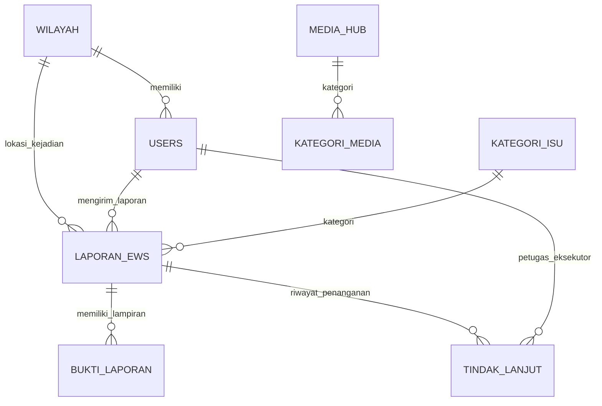
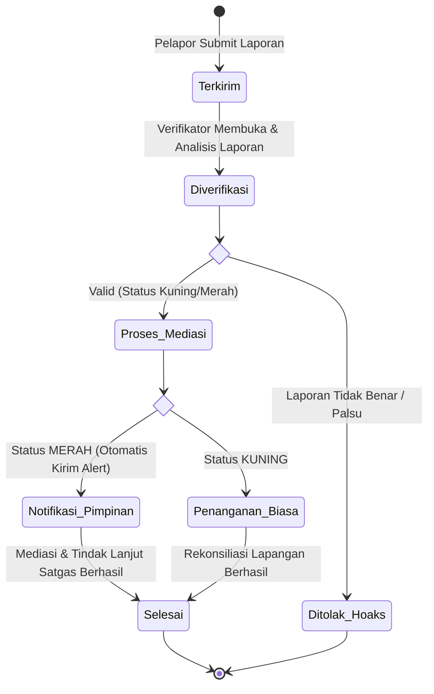

# PROJECT BRIEF & SPESIFIKASI PENGEMBANGAN SISTEM
## PORTAL BERSATU (BERsama Saling jAga Toleransi Umat)
**Instansi:** Kantor Wilayah Kementerian Agama Provinsi Kalimantan Utara  
**Rujukan:** Dokumen Proyek Perubahan PKN Tk. II Angkatan XXX - H. Iramsyah Noor, S.Ag., M.A.P.  
**Lokus Piloting Awal:** Kabupaten Malinau (Cakupan Penuh: 5 Kabupaten/Kota se-Kaltara)

---

### 1. Identitas & Latar Belakang Proyek

* **Nama Proyek:** Portal BERSATU (*BERsama Saling jAga Toleransi Umat*).
* **Judul Aksi:** Strategi Penguatan Early Warning System (EWS) Melalui Promosi Kerukunan Umat Beragama Berbasis Digital Pada Kanwil Kemenag Prov. Kalimantan Utara.
* **Tagline:** *"Merajut Harmoni, Menjaga Kedamaian di Beranda Batas NKRI Melalui Portal EWS"*.
* **Klasifikasi Aplikasi:** Portal Web Responsif berbasis **PWA (*Progressive Web App*)**.
* **Arsitektur Utama:** *Satu Ekosistem, Dua Modul Utama*:
  1. Digital EWS Terintegrasi (Deteksi dini & pemetaan kerawanan berbasis GIS).
  2. Moderation & Tolerance Media Hub (Promosi kerukunan & literasi digital).
* **Landasan Kebijakan:**
  * PBM (Peraturan Bersama Menteri Agama dan Menteri Dalam Negeri) No. 9 & No. 8 Tahun 2006.
  * Asta Cita Poin ke-8 (Menjamin kebebasan beribadah, dialog antariman, mitigasi konflik SARA).
  * Asta Protas Kementerian Agama RI (Meningkatkan Kerukunan & Cinta Kemanusiaan, Digitalisasi Tata Kelola).
* **Masalah Utama yang Diselesaikan:**
  * Deteksi dini potensi konflik keagamaan sebelumnya bersifat parsial, manual, dan lisan (respons lambat: 3–7 hari pascainsiden).
  * Luas wilayah Kaltara (75.467 km², 5 Kab/Kota, 55 Kecamatan) dengan wilayah pedalaman yang hanya terjangkau transportasi sungai atau udara perintis.
  * Wilayah beranda batas NKRI (Sabah & Sarawak) rentan infiltrasi hoaks SARA dan paham transnasional.

---

### 2. Aktor Sistem & Hak Akses (Role-Based Access Control / RBAC)

Sistem membagi akses ke dalam 5 tingkatan pengguna:

1. **Pelapor Khusus Lapangan (*Field Reporter*):**
   * *Aktor:* Penyuluh Agama (anggota IPARI), Kepala KUA, Pengurus FKUB, Tokoh Agama & Lembaga Adat.
   * *Hak Akses:* Input laporan form "Lapor Dini", penandaan koordinat GPS otomatis, upload berkas bukti (foto/surat/audio), pantau riwayat dan status penanganan laporan mandiri.
2. **Masyarakat Terverifikasi (*Verified Citizen*):**
   * *Hak Akses:* Input aduan indikasi awal (masuk antrean moderasi), akses Chatbot "Tanya", direktori rumah ibadah, dan layanan darurat FKUB.
3. **Verifikator / Operator (*Kankemenag Kab/Kota & Kanwil*):**
   * *Hak Akses:* Meninjau laporan masuk, verifikasi faktual lapangan, mengubah/menetapkan status tingkat risiko (Hijau, Kuning, Merah), input catatan rekomendasi mitigasi dan notulen mediasi.
4. **Pimpinan (*Executive Viewer*):**
   * *Aktor:* Kakanwil Kemenag Kaltara, Kakankemenag Kab/Kota, Forkopimda / Bakesbangpol Kaltara.
   * *Hak Akses:* Akses monitoring dashboard agregat provinsi, pemetaan peta spasial GIS sebaran kerawanan, menerima notifikasi darurat instan jika laporan berstatus Merah.
5. **Super Admin / Pengelola Konten:**
   * *Hak Akses:* Manajemen akun pengguna, kurasi dan persetujuan unggahan di Media Hub, pengelolaan basis data FAQ Chatbot.

---

### 3. Ruang Lingkup 5 Kelompok Fitur Inti Aplikasi

#### A. Beranda & Status Kondusivitas Wilayah
* Widget ringkasan status 5 Kabupaten/Kota: Bulungan, Tarakan, Malinau, Nunukan, dan Tana Tidung.
* Indikator warna agregat kondisi keamanan terkini.
* Ticker berita/kabar kerukunan dan agenda kegiatan lintas iman.
* Akses cepat (*Quick Action*) ke modul: "Lapor Dini", "Chatbot Tanya", dan "Hotline FKUB".

#### B. Modul Digital EWS Terintegrasi ("Lapor Dini") & GIS
* **Form Pelaporan Lapangan:**
  * Klasifikasi Isu: Pendirian Rumah Ibadah, Gesekan Antarumat/Ormas SARA, Penyiaran Agama/Penistaan, Aliran Keagamaan Baru, Hoaks Transnasional Perbatasan.
  * Geotagging Otomatis: Tangkap koordinat lintang (*latitude*) dan bujur (*longitude*) dari GPS perangkat.
  * Form Isian: Judul laporan, tanggal kejadian, deskripsi kronologi, estimasi jumlah pihak terlibat.
  * Lampiran Bukti Dukung: Unggah multi-foto lapangan, berkas PDF dokumen/surat, atau rekaman suara.
* **Standardisasi 3 Tingkat Kerawanan (Status Dokumen):**
  * `Hijau` (Kondusif): Peristiwa telah tertangani/diredam, tensi sosial normal.
  * `Kuning` (Potensi Ketegangan / Butuh Mediasi): Ada friksi horizontal atau sengketa izin, memerlukan mediasi segera oleh penyuluh/KUA/FKUB.
  * `Merah` (Ancaman Konflik Mendesak): Eskalasi tinggi, potensi mobilisasi massa/kekerasan fisik, butuh intervensi darurat pimpinan dan aparat keamanan.
* **Sistem Notifikasi Cepat (*Instant Alert*):**
  * Otomatis meneruskan laporan berkategori status `Merah` ke grup komunikasi pimpinan dan tim respons cepat melalui Webhook Telegram/WhatsApp.
* **Dashboard Pemetaan GIS:**
  * Visualisasi peta Kalimantan Utara berbasis Leaflet.js dengan pin koordinat kejadian dan pewarnaan poligon wilayah rawan (*heat map*).

#### C. Chatbot "Tanya" (Asisten AI & Knowledge Base)
* Asisten virtual edukasi aturan PBM No. 9 & 8 Tahun 2006 (prosedur perizinan rumah ibadah, fungsi dan wewenang FKUB).
* Fitur klarifikasi isu dan penangkal hoaks SARA di perbatasan.
* Mekanisme pengalihan (*fallback*) langsung ke nomor kontak hotline FKUB bila jawaban membutuhkan penanganan personal.

#### D. Moderation & Tolerance Media Hub
* **Galeri Konten Moderasi:** Wadah publikasi terkurasi untuk video testimoni tokoh agama & adat, minimal 10 infografis moderasi, serta arsip podcast *"Suara Harmoni Perbatasan"*.
* **Bank Naskah Khotbah:** Ruang unduh materi khotbah/ceramah tematik kerukunan umat dan ekoteologi bagi para penyuluh lintas agama.
* **Filter Konten:** Berdasarkan agama, tema bahasan, dan jenis format berkas.

#### E. Pusat Informasi & Layanan Kerukunan
* Direktori geospasial tempat ibadah resmi terverifikasi per kabupaten/kota.
* Kalender agenda bersama dan forum dialog lintas iman.
* Daftar kontak dan tautan langsung ke sekretariat hotline FKUB se-Kaltara.

---

### 4. Skema Basis Data Inti (Database Schema)

Rancangan tabel basis data relasional (MySQL / PostgreSQL):

1. **`wilayah`**
   * `id` (PK, INT)
   * `kode_bps` (VARCHAR 10)
   * `nama_kabupaten` (VARCHAR 100)
   * `nama_kecamatan` (VARCHAR 100)
   * `latitude_pusat` (DECIMAL 10,8)
   * `longitude_pusat` (DECIMAL 11,8)
   * `polygon_geojson` (TEXT / JSON)

2. **`users`**
   * `id` (PK, BIGINT)
   * `nip_nik` (VARCHAR 30, UNIQUE)
   * `nama_lengkap` (VARCHAR 150)
   * `no_wa` (VARCHAR 20)
   * `email` (VARCHAR 100, UNIQUE)
   * `password_hash` (VARCHAR 255)
   * `role` (ENUM: `superadmin`, `pimpinan`, `verifikator`, `penyuluh_ipari`, `kua`, `fkub`, `masyarakat`)
   * `wilayah_id` (FK `wilayah.id`)
   * `status_aktif` (BOOLEAN, DEFAULT TRUE)

3. **`kategori_isu`**
   * `id` (PK, INT)
   * `nama_kategori` (VARCHAR 100)
   * `deskripsi` (TEXT)

4. **`laporan_ews`**
   * `id` (PK, BIGINT)
   * `nomor_tiket` (VARCHAR 50, UNIQUE) -- Format: EWS-YYYYMMDD-XXXX
   * `pelapor_id` (FK `users.id`)
   * `wilayah_id` (FK `wilayah.id`)
   * `alamat_detail` (TEXT)
   * `latitude` (DECIMAL 10,8)
   * `longitude` (DECIMAL 11,8)
   * `kategori_id` (FK `kategori_isu.id`)
   * `judul_laporan` (VARCHAR 255)
   * `kronologi` (TEXT)
   * `status_kerawanan` (ENUM: `hijau`, `kuning`, `merah`)
   * `status_laporan` (ENUM: `draft`, `terkirim`, `diverifikasi`, `proses_mediasi`, `selesai`, `ditolak_hoaks`)
   * `created_at` (TIMESTAMP)
   * `updated_at` (TIMESTAMP)

5. **`bukti_laporan`**
   * `id` (PK, BIGINT)
   * `laporan_id` (FK `laporan_ews.id`)
   * `file_path` (VARCHAR 255)
   * `tipe_file` (VARCHAR 50) -- image/jpeg, application/pdf, audio/mp3
   * `caption` (VARCHAR 255)

6. **`tindak_lanjut`**
   * `id` (PK, BIGINT)
   * `laporan_id` (FK `laporan_ews.id`)
   * `petugas_id` (FK `users.id`)
   * `catatan_analisis` (TEXT)
   * `rekomendasi_mitigasi` (TEXT)
   * `perubahan_status_kerawanan` (ENUM: `hijau`, `kuning`, `merah`)
   * `tanggal_penanganan` (DATETIME)

7. **`media_hub`**
   * `id` (PK, INT)
   * `judul` (VARCHAR 255)
   * `slug` (VARCHAR 255, UNIQUE)
   * `tipe_konten` (ENUM: `video`, `infografis`, `podcast`, `naskah_khotbah`)
   * `url_file` (VARCHAR 255)
   * `thumbnail_url` (VARCHAR 255)
   * `deskripsi` (TEXT)
   * `tokoh_narasumber` (VARCHAR 150)
   * `status_tampil` (BOOLEAN, DEFAULT TRUE)
   * `published_at` (TIMESTAMP)

8. **`faq_chatbot`**
   * `id` (PK, INT)
   * `pertanyaan_kunci` (VARCHAR 255)
   * `jawaban` (TEXT)
   * `kategori` (VARCHAR 100) -- pbm_2006, moderasi, ekoteologi, perbatasan

---

### 5. Alur Kerja Logika & Status Sistem

---

### 6. Rencana Kerja Pengembang (Timeline 60 Hari / 8 Minggu)

Jadwal mengikuti pentahapan resmi *Milestones Jangka Pendek 60 Hari* pada Slide 7 dokumen:

| Minggu | Tahapan Dokumen | Aktivitas Teknis Pengembang (Prakom) | Output Terverifikasi |
|---|---|---|---|
| **M1** | Tahap 1: Tata Kelola & Persiapan | Setup environment proyek, inisialisasi Git repository, dan pembuatan skrip migrasi database (DDL). | Repositori aktif, struktur tabel terpasang. |
| **M2** | Tahap 1: Tata Kelola & Master Data | Input data referensi 5 Kab/Kota Kaltara, batas wilayah GeoJSON, serta konfigurasi Autentikasi dan Role (RBAC). | Modul autentikasi login multi-role aktif. |
| **M3** | Tahap 2: Pengembangan Sistem (PWA) | Setup konfigurasi PWA (`manifest.json`, Service Worker caching offline) dan layout UI responsif mobile. | Tampilan dasar dapat di-*install* di layar utama HP. |
| **M4** | Tahap 2: Modul EWS Lapor Dini | Implementasi form pelaporan: auto geotagging GPS, upload kompresi gambar, dan alur ubah status (Draft-Terkirim). | Form pelaporan berfungsi penuh dari HP. |
| **M5** | Tahap 2: Modul GIS & Alert | Integrasi Leaflet.js untuk pemetaan pin status Hijau/Kuning/Merah dan webhook bot notifikasi darurat. | Peta interaktif tampil & notifikasi terkirim saat Merah. |
| **M6** | Tahap 2: Media Hub & Chatbot | Bangun katalog Media Hub (video, infografis, khotbah) serta integrasi modul Chatbot "Tanya". | Media Hub dapat diakses publik, Chatbot responsif. |
| **M7** | Tahap 3: Bimtek & Simulasi | Pendampingan teknis dan uji coba penggunaan aplikasi saat Bimtek Penyuluh Agama (IPARI) dan pengurus FKUB. | Catatan bug & revisi antarmuka terhimpun. |
| **M8** | Tahap 4: Piloting & Launching | Pelaksanaan *piloting* uji coba lapangan di lokus percontohan (**Kab. Malinau**), migrasi dan rilis ke server produksi. | Sistem BERSATU beroperasi di domain resmi. |

---

### 7. Strategi Mitigasi Kendala Lapangan

1. **Koneksi Internet Minim di Daerah Pedalaman/Perbatasan:**
   * Aplikasi menggunakan teknologi PWA. Saat perangkat di luar jangkauan sinyal, data laporan disimpan sementara pada penyimpanan lokal (*IndexedDB / LocalStorage*), dan otomatis disinkronisasi ketika perangkat kembali mendapat sinyal.
2. **Perlindungan Identitas Pelapor (*Whistleblower Protection*):**
   * Data identitas pelapor lapangan dienkripsi pada tingkat basis data dan tidak ditampilkan pada tampilan publik maupun pimpinan umum guna mencegah intimidasi di lapangan.
3. **Penyaringan Laporan Hoaks:**
   * Akses pelaporan "Lapor Dini" difokuskan pada pengguna terverifikasi (IPARI, KUA, FKUB). Laporan aduan dari jalur masyarakat umum ditempatkan pada antrean moderasi verifikator sebelum dipetakan ke dashboard resmi.
